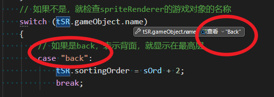
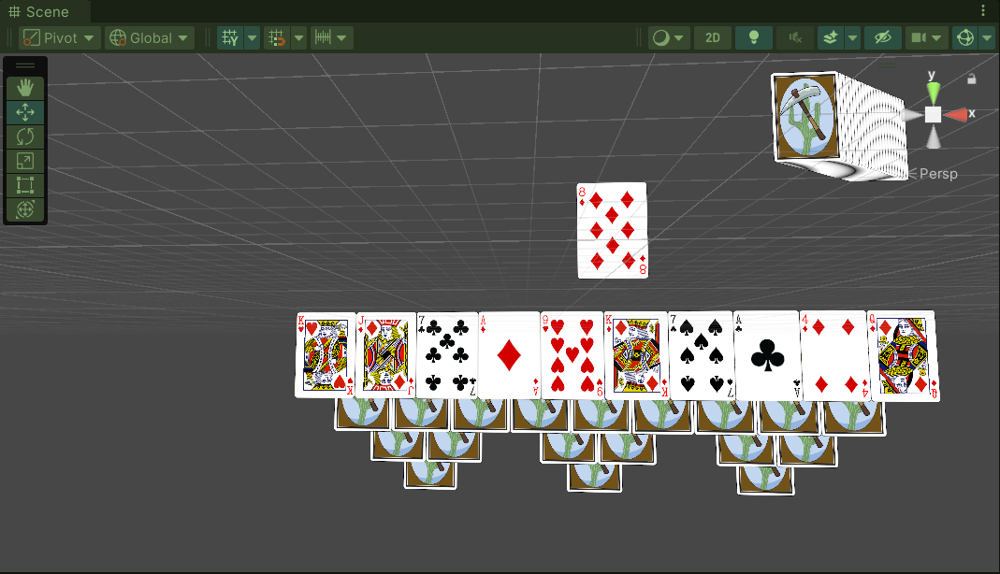

## Prospector

### 游戏简介

《Prospector》（《矿工接龙》）基于经典游戏《Tri-Peaks》，但是两者略有不同。本游戏的目标是在从储备牌堆中翻牌之前的一个回合内，通过更长的连续接龙以获取更多的积分，在一个回合中获得的金色纸牌可使本回合的积分翻倍。——出自《游戏设计、原型与开发》。

---

### 项目介绍

- _Scripts，脚本文件
- Prefabs，预制体文件
- Sprites，卡牌的图像
- Materials，材质文件
- Resources，XML文件资源

`Card`: 用于定义整副纸牌中每张牌的类。`Card`类中还包含了`CardDefinition`类（存储不同点数的纸牌上各个Sprite的位置信息）和`Decorator`类（存储XML文件中定义的角码和角码下的花色符号的信息）。  
`Deck`: 解析Deck_XML.xml中的信息，使用这些信息创建整副纸牌。  
`Prospector`: 控制整个游戏流程。将纸牌归入不同的牌堆中，并管理游戏逻辑。

---

### 实现的功能/需求

#### 制作卡牌的流程

获取XML的卡牌配置信息，根据配置信息创建卡牌。

#### PT_XMLReader

PT_XMLReader是读取Deck_XML.xml文件的信息的脚本，能够读取XML文件中的节点的属性。本游戏中的纸牌是通过代码解析XML文件中关于纸牌上元素的位置、缩放和翻转信息来制作的，不是在引擎中提前制作好52张卡牌的预制体。  

在`ReadDeck()`方法中，我还添加了 使用C#的API实现的读取XML文件版本的代码。  
在使用C#的API时，我曾遇到了几个问题：①读取文件失败；②读取节点失败。  

针对问题①，产生的原因是我使用绝对路径访问Deck_Xml文件，而Deck_Xml文件存放在Resources文件夹里。Unity中，存放在该文件夹下的资源在打包并构建后，会进行加密处理，所以使用绝对路径是无法**正确访问的**。解决方式是使用`Resources.Load<TextAsset>()`获取文件，然后再处理该文件。  

针对问题②，产生的原因是我没有获取XML文件的根节点，直接试图使用`SelectNodes("decorator")`获取根节点下的`decorator`节点。正确的方式是获取根节点，再用根节点调用该方法；或者是在`decorator`前添加`//`表示在全文件中寻找该节点。即使用`SelectNodes("//decorator")`获取指定的节点。

关于`PT_XMLReader.cs`的具体实现，详见代码，源码可见本项目或者该项目：[ProspectorSolitaire/_Prospector Solitaire/Assets/__Scripts/PT_XMLReader.cs at master · ITIGameDesign/ProspectorSolitaire · GitHub](https://github.com/ITIGameDesign/ProspectorSolitaire/blob/master/_Prospector%20Solitaire/Assets/__Scripts/PT_XMLReader.cs)

#### 洗牌功能

传入已创建的卡牌列表，新创建一个临时列表，用于存储洗过的卡牌。接着在`While`循环中获得随机数，将随机数作为索引，将卡牌一个个添加到临时列表。同时删除添加到临时列表的卡牌，此时缩小了原始列表的长度，利用这点作为循环条件，把所有卡牌都搬迁到临时列表。最后再将临时列表赋予原始列表即可。

#### 得分机制

1. 将纸牌从矿井移到目标纸牌 获得1分；
2. 如果一张纸牌从矿井移动到目标位置，而且没有从抽牌堆抽牌，那么这张纸牌获得的分数累加1分。比如，我第一次将矿井的牌移动到目标处，+1；第二次，+2；第三次，+3；第四次，+4；如果第五次，我先从抽牌堆抽一张有效牌了，那么只能+1，相当于连胜断了。
3. 如果玩家赢了一轮，其分数将带到下一轮；如果输了，还是计算输了后的新的一轮开始的回合的总得分，并将总得分和历史最高分比较。
4. 玩家如果获得特殊金纸牌，该轮获得的分数将增加一倍。

---

### 遇到的问题

#### 问题1：同步加载并读取XML文件时遇到的问题

我使用16G内存的轻薄本在脱离电源的情况下，试图使用`Load()`同步获取`XML_Deck`和`XML_DeckLayout`文件时遇到了小麻烦——UnityEditor卡死无响应，风扇缓慢加速。针对此问题，我有两个方案：①连接电源适配器，并在空调房中再次尝试运行；②使用`LoadAsync()`异步加载资源，这样一来需要用到资源的操作均需等待资源加载完毕后才可进行。

在方案②中，我先是仅异步加载了`XML_DeckLayout`文件，但是运行时依旧卡死，此时我陷入了沉思……我又尝试失活跟`Layout.cs`有关的内容，但是依旧卡死。接着我检查`Layout`脚本，发现顶部添加了对`LINQ`和`Xml`的引用，难道和这个有关系？我试着删除了对`LINQ`命名空间的引用，奇迹要发生了吗？此时弹出的是Unity的窗口，显示正在进入播放模式ing……等了1分钟，我重新启动编辑器，再找找原因。**难道是我的电脑太累了！？** 

在连接电源后依然无法响应，我不得不移除相关代码再次尝试一次。此次尝试依旧卡死，我打算在VS中附加到Unity。  
我尝试删除Library文件夹，重新打开。仍然卡死，不行！  
我尝试将读取XML文件均改为异步读取，问题已解决，但是还需完善！XD  
在`InitDeck()`中，原先是先执行`ReadDeck()`，再执行`MakeCards()`；更改后，开启`ReadDeckThread()`协程，等待读取完毕后，再执行`MakeCards()`。使用异步加载XML文件，确保不会卡顿。  
`Layout`脚本中，原先由`Prospector`单例执行加载XML文件并读取XML文件；更改后，在`Prospector`单例中开启一个协程，异步加载`XML_DeckLayout`，并读取该文件。

#### 问题2：将`Card`转换为`CardProspector`

在《矿工接龙》这个游戏中，新建了CardProspector类，该类继承自Card类，并在其基础上扩展，以迎合游戏的需求。将`Card`转换成`CardProspector`这个过程，应该在`Deck.cards`正确赋值后进行，`Deck.cards`的赋值是在协程中执行的，因此转换这个步骤也应该在协程中`cards`被赋值后进行。如果按照这样的步骤，就能正确运行，在`Prospector`类的`drawpile`中能看到52张纸牌。

#### 问题3：调用`Shuffle()`洗牌时卡死

经过断点调试，发现运行至`Shuffle()`时卡死。因此审查`Shuffle()`的内容。

```csharp
public void Shuffle(ref List<Card> oCards)
{
    // tempCards，临时列表，存储洗牌后的纸牌的新顺序
    List<Card> tCards = new List<Card>();
    int ndx;

    while (oCards.Count > 0)
    {
        ndx = Random.Range(0, oCards.Count);
        tCards.Add(oCards[ndx]);
        oCards.RemoveAt(ndx);
        // 原来这行代码在这个位置oCards = tCards;
    }

    oCards = tCards;
}
```

问题出在`oCards = tCards`处。修改前这个循环永远不会结束。

#### 问题4：读取的所有卡牌都背面朝上

原因出在读取XML_Layout文件时，`tSD.faceUp = (slotsX[i].Attributes["faceUp"]?.Value=="1");`，在xml中是`faceup`而不是`faceUp`，是拼写错误产生的。

#### 问题5：重置Prospector类中对流程的控制

在2026-10-17，我将所流程放在协程中进行，但是出现了一个问题——异步加载资源时，在资源加载完毕前，其他方法并没有被阻塞，导致资源加载未完成，但是其他的方法已执行，其他方法使用的是**不完整**的资源。   
因此我得重新考虑整个流程的控制。  
我发现，既然`Load()`动态加载资源会出现卡顿，而我早已把XML文件都放在Prospector中的TextAsset类型变量中了，动态加载资源简直是**多此一举**。我直接按照书中的顺序调用方法，不动态加载资源了，也不会卡顿。  
在今天的调试过程中，我发现了新问题，但是检查后找到了问题所在，这个问题只是代码调用的时机不对，`MoveToTarget(Draw())`和`UpdateDrawPile()`，导致卡组被`Draw()`完了，再`Draw()`就出现了空引用报错。  
代码有一点混乱了，等我后面整理一下。

#### 问题6：卡牌元素的渲染顺序问题

在项目中，规定了空白卡面应第一个渲染，即位于图层的底层；而角码、花色和人脸等元素次之（指空白卡面）渲染，位于中层；而背景应最后渲染，当背景对象激活时，能够覆盖所有元素。但是在运行时出现了问题，背景对象的`sortingOrder = 1`，接下来我将断点调试，尝试解决该问题。



粗心大意了，创建出的子对象是 **"Back"** ，但是判断条件中是 **"back"**。

修改完后，能够正常显示了。



接下来将继续实现游戏逻辑。

#### 问题7：书中使用的GUIText已过时，换用UGUI

